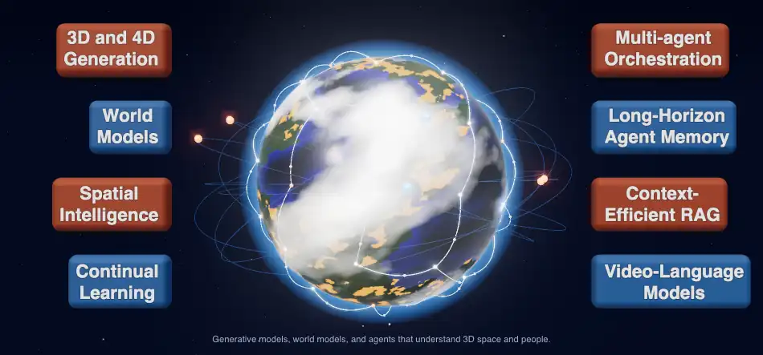
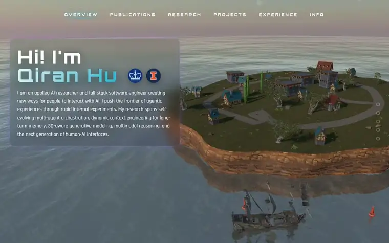
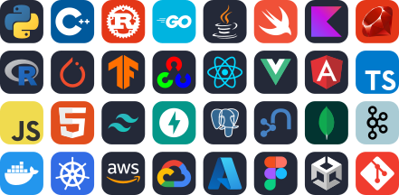

<!-- Generated cards live in assets/ (node scripts/render-assets.mjs) and on the output branch (GitHub Actions). -->
<picture>
  <source media="(prefers-color-scheme: dark)" srcset="assets/hero-dark.svg" />
  <source media="(prefers-color-scheme: light)" srcset="assets/hero-light.svg" />
  
</picture>

<!-- links:start -->

  <a href="https://scholar.google.com/citations?user=4jv03f4AAAAJ&amp;hl=en" title="Google Scholar"><picture><source media="(prefers-color-scheme: dark)" srcset="assets/link-scholar-dark.svg" /><source media="(prefers-color-scheme: light)" srcset="assets/link-scholar-light.svg" /></picture></a>&nbsp;&nbsp;
  <a href="https://edward-h26.github.io/" title="Website"><picture><source media="(prefers-color-scheme: dark)" srcset="assets/link-website-dark.svg" /><source media="(prefers-color-scheme: light)" srcset="assets/link-website-light.svg" /></picture></a>&nbsp;&nbsp;
  <a href="https://www.linkedin.com/in/qiranhu/" title="LinkedIn"><picture><source media="(prefers-color-scheme: dark)" srcset="assets/link-linkedin-dark.svg" /><source media="(prefers-color-scheme: light)" srcset="assets/link-linkedin-light.svg" /></picture></a>&nbsp;&nbsp;
  <a href="mailto:qh2332@columbia.edu" title="Email"><picture><source media="(prefers-color-scheme: dark)" srcset="assets/link-email-dark.svg" /><source media="(prefers-color-scheme: light)" srcset="assets/link-email-light.svg" /></picture></a>&nbsp;&nbsp;
  <a href="https://x.com/QiranHu" title="X"><picture><source media="(prefers-color-scheme: dark)" srcset="assets/link-x-dark.svg" /><source media="(prefers-color-scheme: light)" srcset="assets/link-x-light.svg" /></picture></a>

+1 (347) 957-9176

<!-- links:end -->

  

    I am a current M.S. student in <strong><a href="https://www.engineering.columbia.edu/">Fu Foundation School of Engineering and Applied Science</a></strong> at <strong><a href="https://www.columbia.edu/">Columbia University</a></strong>.
  

  

    I am a research assistant in the <strong><a href="https://vision.ischool.illinois.edu/people/">Computer Vision and Machine Learning Group</a></strong> at <strong><a href="https://www.illinois.edu/">University of Illinois Urbana-Champaign</a></strong>. I am also affiliated with the <strong><a href="https://www.ncsa.illinois.edu/">National Center for Supercomputing Applications</a></strong> and <strong><a href="https://nairrpilot.org/">National Artificial Intelligence Research Resource Pilot</a></strong>.
  

  

    Previously, I received my B.S. in Data Science and Information Science with minors in Computer Science and Statistics at <strong><a href="https://www.illinois.edu/">University of Illinois Urbana-Champaign</a></strong>.
  

  

    I am an applied AI researcher and full-stack software engineer creating new ways for people to interact with AI. I push the frontier of agentic experiences through rapid internal experiments. My research spans recursive self-evolving multi-agent orchestration, dynamic context engineering for long-term memory, 3D-aware generative modeling, multimodal reasoning, and the next generation of human-AI interfaces.
  

## Research Focus

<a href="https://edward-h26.github.io/research/">
<picture>
  <source media="(prefers-color-scheme: dark)" srcset="assets/scenes/planet-dark.webp" />
  <source media="(prefers-color-scheme: light)" srcset="assets/scenes/planet-light.webp" />
  
</picture>
</a>

## Featured Papers

<!-- featured-paper:start -->
<table width="100%">
<tr>
<td width="400" valign="top"></td>
<td valign="top">
<b><a href="https://arxiv.org/abs/2606.31204">AC3S: Adaptive Conditioning for 3D-Aware Synthetic Data Generation</a></b> 
Eric Ji, <b>Qiran Hu</b>, Wufei Ma, Sarthak Jain, Yingying Li, Minh N. Do, Yaoyao Liu 
<i>European Conference on Computer Vision (<b>ECCV</b>) 2026</i>  
<a href="https://arxiv.org/abs/2606.31204"><picture><source media="(prefers-color-scheme: dark)" srcset="assets/paper-link-arxiv-dark.svg" /><source media="(prefers-color-scheme: light)" srcset="assets/paper-link-arxiv-light.svg" /></picture></a>
<a href="https://ac3s.cvmlgroup.web.illinois.edu/"><picture><source media="(prefers-color-scheme: dark)" srcset="assets/paper-link-code-dark.svg" /><source media="(prefers-color-scheme: light)" srcset="assets/paper-link-code-light.svg" /></picture></a>
<a href="https://youtu.be/3jOJaT2a8iQ"><picture><source media="(prefers-color-scheme: dark)" srcset="assets/paper-link-video-dark.svg" /><source media="(prefers-color-scheme: light)" srcset="assets/paper-link-video-light.svg" /></picture></a>
<a href="https://arxiv.org/bibtex/2606.31204"><picture><source media="(prefers-color-scheme: dark)" srcset="assets/paper-link-bibtex-dark.svg" /><source media="(prefers-color-scheme: light)" srcset="assets/paper-link-bibtex-light.svg" /></picture></a>
</td>
</tr>
</table>

<table width="100%">
<tr>
<td width="400" valign="top"></td>
<td valign="top">
<b><a href="https://arxiv.org/abs/2609.11209">REVA: Reusable Evidence View Aggregation for Context-Efficient RAG Serving</a></b> 
Tuan Nguyen, <b>Qiran Hu</b>, Banruo Liu, Khoa D. Doan, Kok-Seng Wong, Fan Lai 
<i>IEEE International Conference on Data Mining (<b>ICDM</b>) 2026</i>  
<a href="https://arxiv.org/abs/2609.11209"><picture><source media="(prefers-color-scheme: dark)" srcset="assets/paper-link-arxiv-dark.svg" /><source media="(prefers-color-scheme: light)" srcset="assets/paper-link-arxiv-light.svg" /></picture></a>
<a href="https://github.com/UIUC-MLSys/REVA"><picture><source media="(prefers-color-scheme: dark)" srcset="assets/paper-link-code-dark.svg" /><source media="(prefers-color-scheme: light)" srcset="assets/paper-link-code-light.svg" /></picture></a>
<a href="https://arxiv.org/bibtex/2609.11209"><picture><source media="(prefers-color-scheme: dark)" srcset="assets/paper-link-bibtex-dark.svg" /><source media="(prefers-color-scheme: light)" srcset="assets/paper-link-bibtex-light.svg" /></picture></a>
</td>
</tr>
</table>
<!-- featured-paper:end -->

## News

- **[September 2026]** I am honored to join [IBM Research](https://research.ibm.com/) as a Research Intern advised by Dr. Dhaval Patel to work on Causal Diagnosis and Intervention Evaluation for [AssetOpsBench](https://github.com/IBM/AssetOpsBench).
- **[September 2026]** I am honored to present our poster [AC3S: Adaptive Conditioning for 3D-Aware Synthetic Data Generation](https://arxiv.org/abs/2606.31204) at the [European Conference on Computer Vision (ECCV) 2026](https://eccv.ecva.net/Conferences/2026) in [Malmö, Sweden](https://eccv.ecva.net/Conferences/2026/Venues), ExHall #107 on September 12.
- **[August 2026]** Our paper [REVA: Reusable Evidence View Aggregation for Context-Efficient RAG Serving](https://arxiv.org/abs/2609.11209) is accepted to the [IEEE International Conference on Data Mining (ICDM) 2026](https://www.datamining.org/).
- **[June 2026]** Our paper [AC3S: Adaptive Conditioning for 3D-Aware Synthetic Data Generation](https://arxiv.org/abs/2606.31204) is accepted to the [European Conference on Computer Vision (ECCV) 2026](https://eccv.ecva.net/Conferences/2026).

## Interactive 3D Portfolio

Click the preview to walk the island: scroll to move, look sideways with the arrow keys. Built with React and three.js.

## Papers

<!-- papers:start -->
<table width="100%">
<tr>
<td width="300" valign="top"></td>
<td valign="top">
<b><a href="https://arxiv.org/abs/2606.31204">AC3S: Adaptive Conditioning for 3D-Aware Synthetic Data Generation</a></b> 
Eric Ji, <b>Qiran Hu</b>, Wufei Ma, Sarthak Jain, Yingying Li, Minh N. Do, Yaoyao Liu 
<i>European Conference on Computer Vision (<b>ECCV</b>) 2026</i>  
<a href="https://arxiv.org/abs/2606.31204"><picture><source media="(prefers-color-scheme: dark)" srcset="assets/paper-link-arxiv-dark.svg" /><source media="(prefers-color-scheme: light)" srcset="assets/paper-link-arxiv-light.svg" /></picture></a>
<a href="https://ac3s.cvmlgroup.web.illinois.edu/"><picture><source media="(prefers-color-scheme: dark)" srcset="assets/paper-link-code-dark.svg" /><source media="(prefers-color-scheme: light)" srcset="assets/paper-link-code-light.svg" /></picture></a>
<a href="https://youtu.be/3jOJaT2a8iQ"><picture><source media="(prefers-color-scheme: dark)" srcset="assets/paper-link-video-dark.svg" /><source media="(prefers-color-scheme: light)" srcset="assets/paper-link-video-light.svg" /></picture></a>
<a href="https://arxiv.org/bibtex/2606.31204"><picture><source media="(prefers-color-scheme: dark)" srcset="assets/paper-link-bibtex-dark.svg" /><source media="(prefers-color-scheme: light)" srcset="assets/paper-link-bibtex-light.svg" /></picture></a>
</td>
</tr>
</table>

<table width="100%">
<tr>
<td width="300" valign="top"></td>
<td valign="top">
<b><a href="https://arxiv.org/abs/2609.11209">REVA: Reusable Evidence View Aggregation for Context-Efficient RAG Serving</a></b> 
Tuan Nguyen, <b>Qiran Hu</b>, Banruo Liu, Khoa D. Doan, Kok-Seng Wong, Fan Lai 
<i>IEEE International Conference on Data Mining (<b>ICDM</b>) 2026</i>  
<a href="https://arxiv.org/abs/2609.11209"><picture><source media="(prefers-color-scheme: dark)" srcset="assets/paper-link-arxiv-dark.svg" /><source media="(prefers-color-scheme: light)" srcset="assets/paper-link-arxiv-light.svg" /></picture></a>
<a href="https://github.com/UIUC-MLSys/REVA"><picture><source media="(prefers-color-scheme: dark)" srcset="assets/paper-link-code-dark.svg" /><source media="(prefers-color-scheme: light)" srcset="assets/paper-link-code-light.svg" /></picture></a>
<a href="https://arxiv.org/bibtex/2609.11209"><picture><source media="(prefers-color-scheme: dark)" srcset="assets/paper-link-bibtex-dark.svg" /><source media="(prefers-color-scheme: light)" srcset="assets/paper-link-bibtex-light.svg" /></picture></a>
</td>
</tr>
</table>

<table width="100%">
<tr>
<td width="300" valign="top"></td>
<td valign="top">
<b>ACDN: Agent-Aware Content Delivery Network</b> 
Tuan Nguyen, <b>Qiran Hu</b>, Dibyadeep Saha, Banruo Liu, Khoa D. Doan, Kok-Seng Wong, Fan Lai 
<i>Under review</i>
</td>
</tr>
</table>

<table width="100%">
<tr>
<td width="300" valign="top"></td>
<td valign="top">
<b>SV4D 3.0: Single-Step 3D-Aware Diffusion for Multi-View-Consistent 4D Scene Generation</b> 
<b>Qiran Hu</b>, Wei Cao, Yaoyao Liu 
<i>Under review</i>
</td>
</tr>
</table>

<table width="100%">
<tr>
<td width="300" valign="top"></td>
<td valign="top">
<b>AISim: Using LLM-Simulation as Epistemic Scaffolds for Early Stage Qualitative Research Design</b> 
Hangyue Zhang, <b>Qiran Hu</b>, Ziyi Zhang, Hyanghee Park, Yun Huang 
<i>Under review</i>
</td>
</tr>
</table>

<table width="100%">
<tr>
<td width="300" valign="top"></td>
<td valign="top">
<b>AlphaWiSE: Adaptive Weight Interpolation for Continual Multimodal Representation Learning</b> 
Sarthak Jain, <b>Qiran Hu</b>, Zhen Zhu, Yaoyao Liu 
<i>Under review</i>
</td>
</tr>
</table>
<!-- papers:end -->

## Research Experience

### **Computer Vision and Machine Learning Group**
**Undergraduate Research Assistant (Advisor: Prof. Yaoyao Liu)** 
_Champaign, IL · 2025.05 - 2026.08_

- Proposed adaptive conditioning methods for 3D-aware synthetic data generation to enhance world model understanding and embodied agent performance in interactive simulations with geometry-conditioned diffusion approaches, reducing FID by 32.8% on ImageNet and improving pose accuracy by 4.2x on PASCAL3D+.
- Scaled foundation-model training through distributed methods across TB-level datasets on National Center for Supercomputing Applications (NCSA) HPC clusters to enforce multi-view consistency with 4-bit NF4 quantization and custom CUDA kernels, decreasing FID by 18.3% on AC3S-50 and reducing generation latency by 78.7% at p95.
- Implemented camera-controlled novel view synthesis for video generation pipelines to advance real-time perception for SLAM, visual odometry, and 3D reconstruction, decreasing LPIPS by 21.0% on GSO and FV4D by 52.0% on OmniObject3D compared to SV4D 2.0.

### **Multi-modal Generative Models for Continual Learning**
**Undergraduate Research Assistant (Advisor: Prof. Yaoyao Liu)** 
_Champaign, IL · 2026.02 - 2026.08_

- Selected for NVIDIA Academic Grant Program Award, AMD University Program, and Lambda Research Grant to streamline class-incremental learning in multimodal foundation models across audio, image, and text without catastrophic forgetting or cross-modal alignment drift, increasing audio-to-text R@1 by 27.6% on AudioSet and raising last-task accuracy by 40.9% on UrbanSound8K.
- Implemented post-hoc tensor-level weight interpolation for multimodal retrieval on National Artificial Intelligence Research Resource (NAIRR) HPC clusters, minimizing trainable parameters from 182M to 499 sigmoid-parameterized coefficients and decreasing training time by 90.2% compared to LwF.
- Optimized checkpoint fusion pipelines to compose frozen checkpoints into one deployable model without additional inference latency, retaining 99.6% of audio-to-text R@1 after shrinking the exemplar memory by 90.0% and enhancing last-task accuracy by 10.9% on CIFAR-100.

### **Reusable Evidence View Aggregation for Context-Efficient RAG Serving**
**Undergraduate Research Assistant** 
_Champaign, IL · 2026.02 - 2026.06_

- Designed attention-based scoring for post-retrieval context compression in retrieval-augmented generation (RAG) to reuse generator attention traces across queries and update scores offline, achieving a 91.6% cache hit rate and boosting F1 by 12.9% on HotpotQA.
- Deployed reusable evidence views keyed to unique documents in order to scale compression cost with documents rather than query volume, improving F1 by 13.2% on Natural Questions and decreasing online compression overhead by 6.1x at under 40 ms per request.
- Accelerated online serving to keep context compression off the GPU critical path, cutting compression latency by 99.3% compared to EXIT and 99.8% compared to FaviComp.

## Professional Experience

### **IBM Research**
**Research Intern (Advisor: Dr. Dhaval Patel)** 
_New York, NY · 2026.09 - Present_

- Lead Model Context Protocol (MCP) server architecture for AssetOpsBench that serves failure-mode knowledge graphs, root-cause ranking, and intervention estimation to multi-turn tool-use large language model (LLM) agents via deterministic Neo4j queries with provenance, raising top-1 tool accuracy by 12.9% compared to per-server sub-agents and cutting standing tool context by 98.5%.
- Design fault-diagnosis reinforcement learning (RL) environments on a hydraulic test rig with verifiable cost-aware rewards, priced observations, and reward-hacking checks for multi-step LLM agents, raising top-1 diagnosis accuracy by 42.6 percentage points compared to a Plan-Execute agent and eliminating 87.7% of model calls per episode.
- Streamline the diagnosis environment into standard Gymnasium and OpenEnv training interfaces for RLVR post-training with GRPO on verl, minimizing per-episode inference latency by 52.7% across 47 recorded fault combinations and saving 47.5% in maintenance cost compared to a do-nothing policy.

### **Memoria**
**Technical Lead** 
_Champaign, IL · 2026.01 - 2026.08_

- Led end-to-end agentic workflow deployments across MCP servers, sub-agents, and agent skills with multi-agent orchestration, permission-aware tool calling, and policy guardrails, accelerating product delivery by 4.0x and boosting overall task success by 17.9% on CL-bench.
- Managed production operations for agentic workflows with logging, tracing, evaluation harnesses, and monthly iteration cycles for client stakeholders, reducing serving cost by 90.5% compared to GPT-4o and improving rule-application task success by 31.2% on CL-bench.
- Integrated recursive self-evolving memory architecture across sessions with cost-aware model routing into enterprise agent workflows, saving 96.0% in token cost compared to GPT-5.1 and increasing procedural task success by 71.4% on CL-bench.

### **Two by Two Learning Center**
**Full Stack Developer** 
_Champaign, IL · 2025.08 - 2025.12_

- Launched NOODEIA, a multi-agent tutoring platform for K-12 students below grade level, to plan, critique, and monitor each user with long-horizon memory, boosting user confidence by 2.44x and increasing independence by 2.35x in counterbalanced within-subjects studies.
- Implemented recursive self-evolving long-term memory on Neo4j to retrieve contextually relevant interactions, accelerating query speed by 3.6x compared to recency-biased FIFO memory on PostgreSQL and minimizing cross-session retrieval to 2.1 s.
- Deployed complexity-aware model selection across planner, retrieval, solver, and critic stages to score each request and route it to the smallest capable model, eliminating 89.9% of monthly serving cost compared to GPT-4o and routing 75% of calls to lighter model tiers.

### **WRC**
**Data Analyst** 
_Champaign, IL · 2024.08 - 2024.12_

- Built paired pre/post analytics pipelines over survey data from 9,935 incoming students, raising correct responses by 14.0% and decreasing ambiguous responses by 61.9%.
- Conducted A/B tests on two consent scenarios to locate where misconceptions persisted after each workshop, increasing accuracy on consent comprehension by 19.5% and cutting persistent misconceptions by 41.6%.
- Designed scenario-based learning modules for underrepresented subgroups, raising correct responses on bystander scenarios by 36.8% and narrowing the gap in correct-response rates between subgroups 5.6x.

## Research Projects

### **Long-Form Video-Language and Audio-Visual Social Understanding**
**Undergraduate Research Assistant** 
_Champaign, IL · 2025.12 - 2026.05_

- Proposed memory-efficient streaming video-language models with temporal transformer blocks for long-form video understanding beyond 30-minute sequences, boosting zero-shot accuracy by 17.4% and cutting peak memory by 58.2% compared to full-sequence attention.
- Developed multimodal fusion pipelines to combine facial action units, body pose, and prosody through cross-modal attention and infer social intent and conversational role from raw recordings, achieving 89.1% accuracy on speaker-role classification over a 2,108-turn bootstrap.
- Scaled end-to-end annotation pipelines for full-length clinical sessions with automatic transcription and labeling, processing recordings 1.4x to 1.7x faster than real time and increasing speaker-role inversion accuracy to 90.0%.

### **Multi-agent Research Synthesis Engine**
**Undergraduate Research Assistant** 
_Champaign, IL · 2025.11 - 2026.05_

- Orchestrated eight specialized agents across a 12-step workflow for literature synthesis to cover planning, retrieval, drafting, reflection, and safety review in a single loop with LLM-as-judge evaluation, scoring 0.955 overall and 0.925 on relevance, safety, and clarity.
- Developed concurrent multi-source retrieval across Semantic Scholar and Tavily with production-grade fallback handling for API failures, cutting query latency from 8.2 s to 4.9 s, a 40.2% reduction.
- Designed customized Model Context Protocol servers to centralize governed tool access behind unified interfaces over academic databases, code repositories, and document stores, cutting serving latency by 87.5%.

### **Realistic Neural Style Transfer Architecture**
**Undergraduate Research Assistant** 
_Champaign, IL · 2025.01 - 2025.08_

- Proposed style transfer frameworks to maintain photorealistic results under highly abstract styles with VGG perceptual losses and edge-preserving constraints, improving SSIM by 77.0% and MS-SSIM by 49.0% compared to TensorFlow's NST.
- Optimized multi-layer Gram matrix losses with adaptive layer weighting to suppress texture and chromatic artifacts, boosting SSIM by 4.4x and MS-SSIM by 6.4x compared to ChatGPT-4o.
- Formulated Sobel edge and total variation losses to keep contours sharp and suppress high-frequency noise, decreasing LPIPS by 23.0% and DISTS by 17.0% compared to TensorFlow's NST.

### **Anime Statistics and Analysis Platform, ASAP**
**Undergraduate Research Assistant** 
_Champaign, IL · 2025.02 - 2025.06_

- Deployed interactive R Shiny analytics platforms to surface anime popularity trends and market opportunities with live Jikan REST API data on 18,000 titles and predictive analysis on shinyapps.io.
- Developed R data pipelines to fetch, clean, and store 18,000 anime titles from the Jikan REST API in SQLite, adding genre, studio, and producer fields for five interactive analysis and recommendation modules.
- Trained random forest models to predict anime scores from engagement features, decreasing test RMSE by 90.1% and raising R² by 3.7% compared to linear regression.

## Teaching

### **CS 107 Data Science Discovery**
**Teaching Assistant** 
_Champaign, IL · 2023.08 - 2026.05_

- Led weekly lab sections and office hours for in-person and online sessions, mentoring 1,200 students every semester and 7,200+ over six semesters for data science foundations in Python, statistical inference, data wrangling, and machine learning.
- Authored DISCOVERY Guides on the course website to provide detailed explanations with applied Python and statistics walkthroughs, giving students a self-serve reference for every lab and homework.
- Designed problem sets, exam questions, test suites, and autograder scripts to deliver instant, consistent feedback to 1,200 students every semester on Mastery Platform, cutting grading turnaround from days to minutes.

## Service

### **OnePromptClaudeCode**
**Lead Developer** 
_Champaign, IL · 2026.03 - Present_

- Maintain an MIT-licensed open-source agent harness for agentic software development, packaging 95 skills, 71 slash commands, 14 specialized agents, 4 hooks, and 10 MCP servers into a one-prompt install that sets up the full plan, build, review, test, and ship workflow on a fresh machine, eliminating 99.5% of environment initialization steps.
- Automate capability routing with a three-tier router that matches each prompt to the skills and agents it needs by keyword, then by session-memory recall, and only then by a 4.5 s model reasoning pass, to load only the matched capabilities and optimize tokens, latency, and cost on every turn, resolving keyword-matched prompts in 120 ms and decreasing routing latency by 97.3% compared to model-only routing.
- Improve the security layer with four lifecycle hooks that screen every tool call before execution, auto-deny destructive shell commands, and confine edits to a directory-scoped sandbox, cutting accidental destructive actions by 32.6%.

## Honors

- [Neo4j Certified Professional](https://graphacademy.neo4j.com/c/2e386da7-2b30-4575-9fd0-b0b0918a6fe0/)
- [Neo4j Graph Data Science Certification](https://graphacademy.neo4j.com/c/6559f827-9dca-4199-bc9d-8be10fd74891/)

## Education

  
  <strong>Columbia University</strong>, New York, NY 
  <strong>M.S. in Data Science</strong> 
  Fu Foundation School of Engineering and Applied Science 
  Courses: High Performance Machine Learning, Algorithms, Continual Learning and Memory Models, Computer Systems 
  <em>2026.09 - Expected 2028.05</em>

 

  
  <strong>University of Illinois Urbana-Champaign</strong>, Champaign, IL 
  <strong>B.S. in Data Science and Information Science</strong> 
  Minors: Computer Science and Statistics 
  Siebel School of Computing and Data Science 
  Honors: Dean's List and James Scholar 
  Courses: Applied Machine Learning, Generative AI for Human-AI Collaboration, Advanced AI Web-App Development, Graph Databases, Data Visualization, Computational Photography, Linear Algebra with Computational Applications 
  <em>2022.08 - 2026.05</em>

 

## Skills

<!-- skills:start -->
**Programming Languages:** Python, C++, C, Rust, Go, Java, Swift, Kotlin, Ruby, R

**AI/ML Frameworks:** PyTorch, CUDA, JAX, TensorFlow, Triton, TensorRT, vLLM, SGLang, NeMo, Megatron-LM, LangGraph, NCCL, GPU/TPU/CPU architecture

**Foundation Model Training:** continual learning, synthetic data generation, distributed training, quantization, context compression, knowledge distillation, pre-training, post-training, reinforcement learning, RLHF, reward modeling, supervised fine-tuning (SFT), direct preference optimization (DPO), PPO, GRPO, RLAIF, RLVF, model alignment and instruction following, test-time training, token pruning, kernel optimization, LoRA, QLoRA, FSDP

**Computer Vision:** diffusion models, 3D/4D image and video generation, novel view synthesis, multi-view geometry consistency, 3D reconstruction, world models, depth estimation, visual-inertial odometry, SLAM, spatial intelligence, autoregressive models, flow matching, NeRFs, 3D Gaussian Splatting, OpenCV

**Agentic AI:** multi-agent orchestration, tool calling, agent harness, long-horizon agent memory, context engineering, RAG, MCP, policy guardrails, sub-agent parallelization, prompt caching, computer-use agents, A2A

**Full-stack Development:** TypeScript, JavaScript, React, Tailwind CSS, FastAPI, HTML5, Vue, Angular

**Databases and Infrastructure:** PostgreSQL, Neo4j, MongoDB, Kafka, Docker, Kubernetes, CI/CD, cloud platforms (AWS, GCP, Azure)

**Design and Other Tools:** Figma, Canva, Adobe Creative Suite, Microsoft Office Suite, Unity

**Languages:** Chinese (native), English (native), Spanish (limited working proficiency)
<!-- skills:end -->

<picture>
  <source media="(prefers-color-scheme: dark)" srcset="assets/skills-marquee-dark.svg" />
  <source media="(prefers-color-scheme: light)" srcset="assets/skills-marquee-light.svg" />
  
</picture>

  

## GitHub Activity

<picture>
  <source media="(prefers-color-scheme: dark)" srcset="https://raw.githubusercontent.com/Edward-H26/Edward-H26/output/stats-dark.svg" />
  <source media="(prefers-color-scheme: light)" srcset="https://raw.githubusercontent.com/Edward-H26/Edward-H26/output/stats-light.svg" />
  
</picture>

<picture>
  <source media="(prefers-color-scheme: dark)" srcset="https://raw.githubusercontent.com/Edward-H26/Edward-H26/output/code-dark.svg" />
  <source media="(prefers-color-scheme: light)" srcset="https://raw.githubusercontent.com/Edward-H26/Edward-H26/output/code-light.svg" />
  
</picture>

  <picture>
    <source media="(prefers-color-scheme: dark)" srcset="https://raw.githubusercontent.com/Edward-H26/Edward-H26/output/contrib-3d-dark.svg" />
    <source media="(prefers-color-scheme: light)" srcset="https://raw.githubusercontent.com/Edward-H26/Edward-H26/output/contrib-3d-light.svg" />
    
  </picture>

<picture>
  <source media="(prefers-color-scheme: dark)" srcset="https://raw.githubusercontent.com/Edward-H26/Edward-H26/output/snake-dark.svg" />
  <source media="(prefers-color-scheme: light)" srcset="https://raw.githubusercontent.com/Edward-H26/Edward-H26/output/snake-light.svg" />
  
</picture>

<!-- views:start -->

  

<!-- views:end -->
